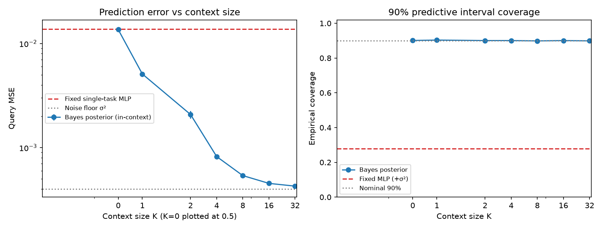

# Pendulum World Model + PFN-style In-Context Dynamics

在 Gymnasium `Pendulum-v1` 上学习动力学并用于模型预测控制（MPC），再将固定动力学扩展为从先验采样的任务族，用 PFN 式 Transformer 从上下文转移中预测角速度增量，并与精确贝叶斯后验对照。

这是低维合成任务上的概念验证（proof of concept），不声称提出新算法，也不是 PFN 原论文复现。背景：IMDS。

## 研究问题

1. 学到的动力学能否支持多步预测和 MPC？预测误差如何累积？
2. 加入角度积分和 cos/sin 重建的物理结构，能否改善单步预测？
3. 参数变化后，能否固定网络权重，仅利用少量上下文转移给出准确且校准合理的预测分布？

## 方法（Method）

### 单任务世界模型与 MPC

观测为 `[cos(theta), sin(theta), omega]`，动作为力矩 `u`。随机策略采集的数据按完整 episode 分为 train/val/test = 6/2/2，对应 1200/400/400 条转移；只在训练集拟合输入归一化统计量。原始 test 划分未用于评估。

普通残差 MLP：`[cos(theta), sin(theta), omega, u] → delta_obs`，网络 4→64→64→3，共 4675 参数；`next_obs = current_obs + delta_obs`。
物理结构模型为 4→64→64→1，共 4545 参数，只预测 `delta_omega`，然后裁剪新速度、积分角度并重建 cos/sin：

```text
omega_next = clip(omega + delta_omega, -8, 8)
theta_next = theta + dt * omega_next
obs_next = [cos(theta_next), sin(theta_next), omega_next]
```

该结构没有内置完整单摆方程。单位圆约束成立不代表角度预测一定准确。
MPC 使用 random shooting 比较候选动作序列的累计预测奖励，只执行首个动作，再根据真实观测重新规划。
Oracle 诊断共享候选库及选择流程，将评分动力学替换为真实仿真器；每条候选从同一真实状态副本出发。

### PFN 式上下文动力学

每个任务采样一组固定参数，任务内独立采样状态与动作点，而非连续轨迹：

```text
a ~ N(15, 3²), b ~ N(3, 0.75²), independent
theta ~ U[-pi, pi], omega ~ U[-6, 6], u ~ U[-2, 2]
x = [sin(theta), u]
y = dt * (a * sin(theta) + b * u) + epsilon
dt = 0.05, epsilon ~ N(0, 0.02²)
```

先验不截断，标签不做速度裁剪；这与 Gym 中带速度裁剪的真实转移不完全相同。高斯先验理论上可能采到非物理系数，本任务应理解为合成统计模型。默认物理参数对应 `(a,b)=(15,3)`。

- **贝叶斯参照**：令 `phi = dt * x`，用已知先验和噪声的共轭线性回归计算精确后验预测均值和方差。方差包含参数不确定性与观测噪声；这不是给每个有限样本保证的误差上界。
- **PFN**：上下文 token `[sin(theta), u, y, 1]`，查询 token `[sin(theta), u, 0, 0]`。两层 TransformerEncoder，d=64，4 头，pre-norm，高斯输出头；K=0 时加入可学习先验 token。**实际代码使用联合自注意力，未屏蔽查询间交互；预测可依赖同批其他查询特征，查询标签不作为输入。**因此现有结果属于联合查询设置，尚未验证逐查询独立推断。源代码中的独立性注释和测试名表述过强：现有测试检查的是查询置换等变性。
- **固定 MLP**：复用单任务模型及配套归一化统计量，无上下文输入。为计算 NLL 和覆盖率，预先指定预测分布 `N(MLP_mean, 0.02²)`，未在评估标签上拟合方差。

归档 PFN 训练：seed=0，CPU 单线程，Adam lr=0.001，3000 次更新，每批 64 个任务，Q=16，K 从 `{0,1,2,4,8,16}` 采样，用高斯 NLL 训练。网络 71558 参数，记录耗时 74.102 秒；该时间仅代表当时机器上的一次运行。
评估使用种子 20261028 的 1000 个新合成任务，每任务 Q=20，K 取同一组 32 个上下文点的嵌套前缀。K=32 未用于训练，但任务仍来自同一先验，不能称为任务分布外泛化。

证据：[PFN 训练配置与记录](results/day15_pfn_20261028T162639_073060/metrics.json)、[评估协议与结果](results/day15_eval_20261028T162911_018421/metrics.json)。

## 主要结果（Results）

### 单步预测与多步误差

| 模型 | 单步验证 MSE | 参数量 |
|---|---:|---:|
| 普通残差 MLP | 3.098781e-4 | 4675 |
| 物理结构模型 | 1.073611e-5 | 4545 |

证据：[单步模型比较 JSON](results/day10_day08_adam_20261018T102005_973952/comparison.json)，两组 seed=0、Adam、各 1950 次更新。结构模型本次单步误差更低，尚未验证其控制收益。

| 递推长度 h | 第 h 步末步观测 MSE |
|---|---:|
| 1 | 3.098035e-4 |
| 5 | 2.812141e-3 |
| 10 | 1.593984e-2 |
| 20 | 3.660240e-1 |

证据：[多步比较 JSON](results/day10_day09_horizons_20261018T103223_004434/comparison.json)。同一模型、两条验证 episode、362 个共同起点；重叠窗口不是独立重复。这是第 h 步末步误差，不是前 h 步均值，也不是 MPC 规划长度。


### MPC 与 Oracle 诊断

| H | learned 成功回合 | oracle 成功回合 |
|---|---:|---:|
| 5 | 0/6 | 0/6 |
| 15 | 6/6 | 6/6 |
| 30 | 6/6 | 6/6 |

证据：[控制比较 JSON](results/day10_oracle_20261018T110145_857569/comparison.json)、[完整协议](docs/oracle_protocol.md)。每行每种后端汇总两个候选数（20、200）和三个环境种子；随机策略为 0/3。成功指真实状态连续至少 20 步满足角度与角速度阈值，中途成功不等于最终稳定。

H=5 时准确动力学也未成功，支持短规划设定构成限制；不能证明模型误差没有影响或确定唯一失败原因。有限候选数、搜索覆盖和终值设计也影响规划。更长规划不保证更高真实回报。

### 上下文动力学

| K | 方法 | 查询 MSE ± 跨任务标准误 | Gaussian NLL | 90% 区间覆盖率 |
|---:|---|---:|---:|---:|
| 0 | PFN | 1.396028e-02 ± 5.313e-04 | -0.846373 | 0.931400 |
| 0 | 贝叶斯 | 1.360445e-02 ± 5.296e-04 | -0.885856 | 0.901100 |
| 0 | 固定 MLP | 1.371745e-02 ± 5.300e-04 | 14.153734 | 0.278850 |
| 1 | PFN | 5.983714e-03 ± 3.066e-04 | -1.337322 | 0.924300 |
| 1 | 贝叶斯 | 5.096473e-03 ± 2.778e-04 | -1.493760 | 0.903450 |
| 1 | 固定 MLP | 1.371745e-02 ± 5.300e-04 | 14.153734 | 0.278850 |
| 2 | PFN | 3.229590e-03 ± 1.941e-04 | -1.601092 | 0.937750 |
| 2 | 贝叶斯 | 2.080053e-03 ± 1.727e-04 | -1.913803 | 0.900600 |
| 2 | 固定 MLP | 1.371745e-02 ± 5.300e-04 | 14.153734 | 0.278850 |
| 4 | PFN | 1.623613e-03 ± 6.725e-05 | -1.870742 | 0.950800 |
| 4 | 贝叶斯 | 8.205180e-04 ± 2.953e-05 | -2.208041 | 0.900650 |
| 4 | 固定 MLP | 1.371745e-02 ± 5.300e-04 | 14.153734 | 0.278850 |
| 8 | PFN | 9.083460e-04 ± 2.714e-05 | -2.090731 | 0.956600 |
| 8 | 贝叶斯 | 5.385899e-04 ± 8.450e-06 | -2.356527 | 0.898650 |
| 8 | 固定 MLP | 1.371745e-02 ± 5.300e-04 | 14.153734 | 0.278850 |
| 16 | PFN | 6.326316e-04 ± 1.267e-05 | -2.238257 | 0.958650 |
| 16 | 贝叶斯 | 4.534453e-04 ± 5.137e-06 | -2.431368 | 0.900600 |
| 16 | 固定 MLP | 1.371745e-02 ± 5.300e-04 | 14.153734 | 0.278850 |
| 32 | PFN | 5.558425e-04 ± 9.131e-06 | -2.304225 | 0.946300 |
| 32 | 贝叶斯 | 4.266489e-04 ± 4.415e-06 | -2.461048 | 0.898900 |
| 32 | 固定 MLP | 1.371745e-02 ± 5.300e-04 | 14.153734 | 0.278850 |

证据：[三方法评估 JSON](results/day15_eval_20261028T162911_018421/metrics.json)。标准误按 1000 个任务计算，不把同任务 20 个查询点当成独立任务。Gaussian NLL 可为负值；该处评价的是连续概率密度。




贝叶斯和 PFN 的 MSE 在本次 K 网格上随 K 增加而降低。K=32 时 PFN 为 5.558425e-4，贝叶斯为 4.266489e-4，观测噪声方差为 4.0e-4；PFN 仍存在与精确后验的差距。固定 MLP 为 1.371745e-2，因输入和权重不随 K 改变而保持不变。
PFN 的 90% 区间经验覆盖率约 0.92–0.96，整体偏保守，不能仅据此声称已经校准良好；贝叶斯约 0.90。在人为指定的仅含观测噪声方差下，固定 MLP 覆盖率约 0.28，说明这种预测分布过度自信，不代表它自身学习过不确定性。

## 本项目的贡献（Contributions）

1. 将固定参数的单摆世界模型扩展为任务族上的上下文推断，构建世界模型与 PFN 思路的最小可验证结合点。
2. 选择对参数线性、先验与噪声高斯的任务，提供精确后验预测参照，同时比较 MSE、NLL 和预测区间覆盖率。
3. 通过准确动力学替换诊断，区分预测误差与规划设置的限制；不把单步 MSE 改善直接等同于控制收益。
4. 按完整 episode 划分数据、训练集拟合统计量、保留未使用的 test 划分及独立结果归档，并报告优化配置敏感性和重叠窗口的统计限制。

## 局限性（Limitations）

- 任务生成模型与贝叶斯假设一致，未测试先验错配、阻尼、摩擦或未知非线性；动力学对状态仍含正弦非线性，只对系数线性。
- PFN 只有一次训练和一个评估种子。跨任务标准误不表示跨训练种子的稳定性。
- K=32 是未见过的上下文长度，任务来自相同先验。联合查询特征间的交互也限制了逐查询部署解释。
- 高斯输出替代原 PFN 的分段分布；未做后验一致性证明或额外校准。
- 固定 MLP 不使用上下文，且训练状态分布及速度裁剪目标与合成任务不完全一致，属于能力边界参照，不是条件完全对等的算法比较。
- PFN 尚未接入 MPC 闭环，尚无上下文推断带来控制收益的证据。
- 单任务结果主要来自单训练种子；验证集参与早停和配置选择，是开发证据。MPC 只有三个环境种子；两条验证 episode 的重叠窗口不独立。原始 test 划分从未评估。

## 下一步（Future Work）

将 PFN 接入参数未知单摆的 MPC；研究多步误差和风险敏感规划；检验先验错配与非线性任务族；增加训练种子并评估校准。逐查询部署前需明确注意力掩码协议，并重新训练和评价对应模型。

## 复现（Reproduce）

Windows / Python 3.11 / CPU。以下命令供读者选择执行；发布准备过程中没有运行训练或重新运行归档实验。

```powershell
python -m venv .venv
.venv\Scripts\python -m pip install torch==2.10.0 --index-url https://download.pytorch.org/whl/cpu
.venv\Scripts\python -m pip install -r requirements.txt
.venv\Scripts\python -X utf8 -B -m pytest tests -q -p no:cacheprovider

# 只读归档数字，不加载模型、不重跑实验
.venv\Scripts\python -X utf8 -B -m scripts.release_read_metrics

# 可选：重新评估已归档模型，会新建带时间戳的结果目录
.venv\Scripts\python -X utf8 -m scripts.day15_eval_baseline
.venv\Scripts\python -X utf8 -m scripts.day15_eval_pfn results/day15_pfn_20261028T162639_073060

# 可选：重新训练，而非只读已有结果
.venv\Scripts\python -X utf8 -m scripts.day15_train_pfn --run
```

`pytest.ini` 同时收集 `test_*.py` 和 `day15_test_*.py`，防止漏掉 Day15 测试。单元测试会执行小型合成前向/梯度检查、短仿真及临时目录中的替身归档，不运行实验训练或完整 MPC 网格，也不评估原始 test 划分。

发布副本在全新虚拟环境中验证：**77 passed，4 warnings，14.03 秒**。四条提示均为 pre-norm Transformer 未启用 nested-tensor 优化，不是测试失败。实际依赖版本见 [环境记录](docs/runtime_versions.json)，核验范围见 [发布验证](docs/release_validation.json)。

重新评估/训练会生成新的带时间戳目录；性能和数值会随硬件与依赖变化。归档 JSON 保存了当时的配置和来源哈希。公开副本只修复必要的文档/资源路径，核心模型和归档权重保留原样。

## 目录结构

| 目录 | 内容 |
|---|---|
| `src/` | 回归、单摆、动力学模型、MPC、PFN 与贝叶斯核心 |
| `scripts/` | 采集、实验、只读数字提取与绘图入口；保留匿名化的幻灯片生成脚本 |
| `tests/` | 单元测试和有限协议检查 |
| `results/` | 历史配置、权重、指标、轨迹与源码快照 |
| `figures/` | 从原归档直接复制的三张展示图 |
| `docs/` | 公开研究报告、数字证据与 Oracle 协议 |

不包含 PPT、个人简历、论文全文或译本、教学日志。幻灯片生成脚本的输出目录 `presentation/` 会在读者主动运行时创建。

| 文件前缀 | 实验内容 |
|---|---|
| `day01`–`day05` | 回归、数据采集、单步和多步预测 |
| `day06` | MPC 与随机策略对照 |
| `day08` | 物理结构模型 |
| `day09`、`day10` | 数据量、预测长度、优化配置复核和 Oracle 诊断 |
| `day15` | PFN 任务先验、贝叶斯、训练、评估与幻灯片生成 |

早期 `day04`、`day08`、`day09` 中的旧 SGD 结果作为历史保留，主要结果以本文引用的 `day10_*` 和 `day15_*` 为准。失败的 Day15 评估目录和 Oracle 归档中的教学计划快照未发布；其余复制的历史证据未改写。部分历史 Markdown 链接指向未公开的教学文档，当前公开入口以本文和 [研究报告](docs/report.md) 为准。

## 参考文献（References）

- Müller et al. [Transformers Can Do Bayesian Inference](https://arxiv.org/abs/2112.10510). ICLR 2022.
- Nagler. [Statistical Foundations of Prior-Data Fitted Networks](https://proceedings.mlr.press/v202/nagler23a.html). ICML 2023.
- Farama Foundation. [Gymnasium Pendulum 文档](https://gymnasium.farama.org/environments/classic_control/pendulum/).
- Yue, Yang, Zhu. [DeltaPhi: Physical States Residual Learning for Neural Operators in Data-Limited PDE Solving](https://proceedings.neurips.cc/paper_files/paper/2025/hash/12bf28fb68f295f855a5bf0c5a217d6e-Abstract-Conference.html). NeurIPS 2025。仅作相关阅读；本项目的时间增量不等同于其解间残差。

## License

[MIT](LICENSE)，Copyright © 2026 zoechen281。
