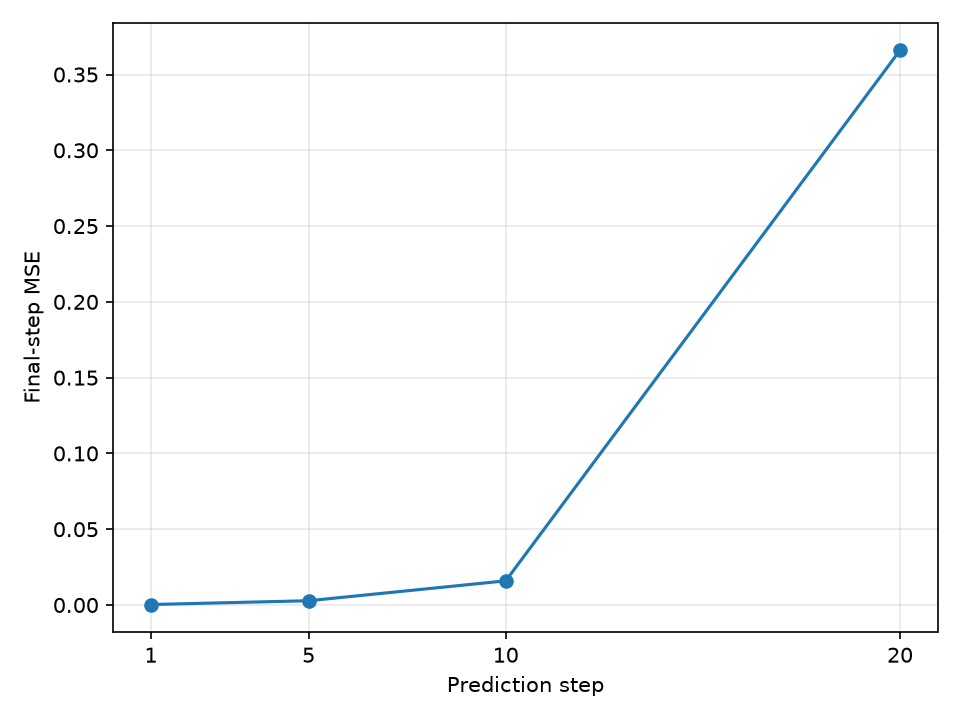
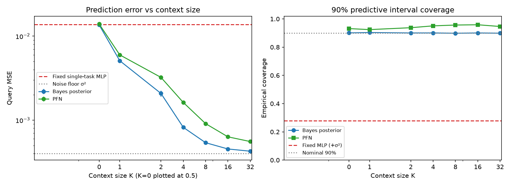

# 单摆世界模型与 PFN 式上下文动力学：公开研究报告（审阅稿）

本文由原研究记录及已归档实验整理，涵盖单任务预测、MPC 诊断与合成任务族上的上下文推断。本文只报告已存在证据，不新增实验，不使用原始 test 划分。数字的机器可读索引见 [evidence.json](evidence.json)，首页概览见 [README](../README.md)。

## 1. 研究问题与假设

单步预测更准确，未必意味着多步控制更好：闭环表现还依赖规划长度、候选搜索和误差累积。物理结构可能改善观测一致性及单步误差，但控制收益必须另行验证。

固定参数模型面对参数变化时，缺少利用新任务转移样本的机制。本项目将任务参数采样自已知先验，检验固定网络权重下的上下文预测，并用精确后验作为参照。实验不预设 PFN 优于贝叶斯。

## 2. 单任务实验协议

Gymnasium Pendulum-v1 的观测为 cos(theta)、sin(theta)、omega，动作是力矩。按完整 episode 划分训练/验证/测试为 6/2/2，对应 1200/400/400 条转移；归一化统计量仅来自训练集。测试划分未评估。验证集参与早停和配置选择，故验证结果属于开发证据。

普通 MLP 预测原尺度观测增量，4→64→64→3；结构模型 4→64→64→1，只预测角速度增量，再裁剪速度、积分角度、重建 cos/sin。两组隐藏层初始化一致，但输出头及参数量不同，没有隔离每一结构组件的贡献。

新配置使用 seed=0、Adam lr=0.001、1950 次更新。普通与结构模型验证 MSE 分别为 3.098781e-4、1.073611e-5。单位圆一致性来自重建步骤，不是角度准确性证明；结构模型尚无控制评价。

证据：`results/day10_day08_adam_20261018T102005_973952/comparison.json`。

旧 SGD 配置与新 Adam 配置的数据量排序相反。新配置 200/1200 条训练转移的验证 MSE 为 7.692944e-4 / 2.941886e-4；两组共用小组训练统计量和初始权重，各执行相同更新次数。优化器、学习率、更新预算与样本覆盖等因素尚未完全隔离，不作“数据越多越好/越差”的普遍因果判断。

证据：`results/day10_day09_adam_20261018T103015_801539/comparison.json`；旧结果见 `results/day09_data_amount_20261017T130753_993032/comparison.json`。

## 3. 多步预测与控制

多步递推将预测观测与后续记录动作重新输入模型。两条验证 episode 共有 362 个共同起点，各预测长度比较使用相同起点，窗口不跨重置。第 1/5/10/20 步末步 MSE 为 3.098035e-4 / 2.812141e-3 / 1.593984e-2 / 0.366024；第 20 步约为单步的 1181 倍。它们是末步误差，不是前 h 步的均值；重叠窗口不构成 362 个独立重复。

证据：`results/day10_day09_horizons_20261018T103223_004434/comparison.json`。



MPC 的 random shooting 累加模型预测奖励，仅执行首个动作，再依据真实反馈滚动规划。准确动力学 Oracle 采用相同候选库与选择流程，每条候选从同一真实状态副本出发。

H∈{5,15,30}、N∈{20,200}、环境种子 100/101/102；learned/oracle 加随机策略共 39 回合，各最多 200 步。成功要求真实状态连续至少 20 步满足 |wrap(theta)|<0.2、|omega|<1。

| H | learned | oracle |
|---|---:|---:|
| 5 | 0/6 | 0/6 |
| 15 | 6/6 | 6/6 |
| 30 | 6/6 | 6/6 |

随机策略成功 0/3。H=5 时连精确评分也失败，支持短规划设置构成限制；不能排除有限候选覆盖、终值设计或模型误差的作用。H=15/30 的成功只说明模型足以支持这些开发案例，不保证更长规划回报更高。中途保持成功与末尾稳定分别报告。

证据：`results/day10_oracle_20261018T110145_857569/comparison.json`；公开判读规则见 [Oracle 协议](oracle_protocol.md)。

## 4. 合成任务族与贝叶斯参照

每个任务内共享 a、b，任务间独立采样 a~N(15,9)、b~N(3,0.5625)。各点独立采样 theta∈[-pi,pi]、omega∈[-6,6]、u∈[-2,2]，均为均匀分布。输入 x=[sin(theta),u]，目标 y=0.05*(a*sin(theta)+b*u)+epsilon，epsilon~N(0,0.0004)。

未截断高斯与未裁剪增量保留共轭结构；极少数负系数在理论上可能出现。不能把该任务与所有真实物理单摆或带速度裁剪的 Gym 标签等同。params 仅作诊断；obs_qry 只供固定 MLP 使用，贝叶斯与 PFN 不直接接收真实参数。

令 beta=[a,b]、Phi=dt*x_ctx，先验均值 mu0、协方差 Sigma0=diag(9,0.5625)，则：

```text
Lambda = inv(Sigma0) + transpose(Phi) @ Phi / sigma²
Sigma_n = inv(Lambda)
mu_n = Sigma_n @ (inv(Sigma0) @ mu0 + transpose(Phi) @ y_ctx / sigma²)
mean_q = phi_q @ mu_n
var_q = phi_q @ Sigma_n @ transpose(phi_q) + sigma²
```

最后一式逐查询取标量。sigma² 是新观测噪声，不能在评价含噪声 y 时省略。K=0 退化为先验预测。后验为精确参照，并非有限样本实际误差的确定性上界。

## 5. PFN 实现和训练

上下文 token 为 [sin(theta),u,y,1]，查询 token 为 [sin(theta),u,0,0]。TransformerEncoder 两层、d=64、四头、pre-norm，高斯头输出 mean/log_var；K=0 加可学习先验 token。使用高斯 NLL，输入中没有查询标签。

重要实现边界：当前注意力没有屏蔽查询间交互，所有 token 联合编码。每个查询预测可以依赖其他查询特征。因此本报告只描述联合查询实验。源码“查询独立”注释及对应测试名称过强；该测试实际验证的是置换等变性。不能用现有结果推断逐查询独立部署效果。发布未修改模型计算或归档权重。

seed=0、CPU 单线程、Adam lr=0.001、3000 步、每批 64 个任务、每任务 Q=16，K 从 {0,1,2,4,8,16} 采样。71558 参数；归档训练耗时 74.102 秒。末次训练批 NLL=-2.088809，不能将变化 K 下的单批损失作为固定验证集曲线。

证据：`results/day15_pfn_20261028T162639_073060/metrics.json`。

## 6. 评价与结果

评价种子 20261028，1000 个新合成任务，每任务 20 个查询；全部方法共用任务和查询，K 使用同一 32 条上下文的嵌套前缀。评估数据未参与训练。K=32 只代表训练中未见过的长度，任务先验没有变化。

固定 MLP 使用归档单任务权重及匹配归一化统计量，取输出的角速度增量。其预测方差预先设为 sigma²；它没有学习不确定性，也不接收上下文。原 val 协议加载检查的全观测 MSE 为 3.099949e-4，不与合成查询增量 MSE 混淆。

| K | 方法 | 查询 MSE ± 跨任务标准误 | Gaussian NLL | 90% 区间覆盖率 |
|---:|---|---:|---:|---:|
| 0 | PFN | 1.396028e-02 ± 5.313e-04 | -0.846373 | 0.931400 |
| 0 | 贝叶斯 | 1.360445e-02 ± 5.296e-04 | -0.885856 | 0.901100 |
| 0 | 固定 MLP | 1.371745e-02 ± 5.300e-04 | 14.153734 | 0.278850 |
| 1 | PFN | 5.983714e-03 ± 3.066e-04 | -1.337322 | 0.924300 |
| 1 | 贝叶斯 | 5.096473e-03 ± 2.778e-04 | -1.493760 | 0.903450 |
| 1 | 固定 MLP | 1.371745e-02 ± 5.300e-04 | 14.153734 | 0.278850 |
| 2 | PFN | 3.229590e-03 ± 1.941e-04 | -1.601092 | 0.937750 |
| 2 | 贝叶斯 | 2.080053e-03 ± 1.727e-04 | -1.913803 | 0.900600 |
| 2 | 固定 MLP | 1.371745e-02 ± 5.300e-04 | 14.153734 | 0.278850 |
| 4 | PFN | 1.623613e-03 ± 6.725e-05 | -1.870742 | 0.950800 |
| 4 | 贝叶斯 | 8.205180e-04 ± 2.953e-05 | -2.208041 | 0.900650 |
| 4 | 固定 MLP | 1.371745e-02 ± 5.300e-04 | 14.153734 | 0.278850 |
| 8 | PFN | 9.083460e-04 ± 2.714e-05 | -2.090731 | 0.956600 |
| 8 | 贝叶斯 | 5.385899e-04 ± 8.450e-06 | -2.356527 | 0.898650 |
| 8 | 固定 MLP | 1.371745e-02 ± 5.300e-04 | 14.153734 | 0.278850 |
| 16 | PFN | 6.326316e-04 ± 1.267e-05 | -2.238257 | 0.958650 |
| 16 | 贝叶斯 | 4.534453e-04 ± 5.137e-06 | -2.431368 | 0.900600 |
| 16 | 固定 MLP | 1.371745e-02 ± 5.300e-04 | 14.153734 | 0.278850 |
| 32 | PFN | 5.558425e-04 ± 9.131e-06 | -2.304225 | 0.946300 |
| 32 | 贝叶斯 | 4.266489e-04 ± 4.415e-06 | -2.461048 | 0.898900 |
| 32 | 固定 MLP | 1.371745e-02 ± 5.300e-04 | 14.153734 | 0.278850 |

证据：`results/day15_eval_20261028T162911_018421/metrics.json`；加载检查见 `results/day15_baseline_20261027T231622_013858/metrics.json`。



标准误先对每任务查询误差求均值，再按任务计算；不能代替跨训练种子的波动。PFN 在本次网格随 K 增加而改善，仍落后于精确贝叶斯参照。已知噪声的期望 MSE 下限为 0.0004，不是每次有限样本结果必须达到的硬界。

PFN 的覆盖率高于名义 90%，整体偏保守；单一覆盖率不能完整证明校准。固定 MLP 覆盖率低说明“均值加纯观测噪声”的人为分布不足以覆盖参数变化误差，不能推断所有 MLP 方法都如此。

## 7. 贡献、局限与下一步

本项目的贡献是将固定动力学问题扩展为带已知任务先验的上下文预测，构造精确后验对照，同时把点误差、不确定性与控制诊断分开评价。该组合是概念验证，没有提出新算法。

局限包括：正确设定的合成先验；单训练与单评估种子；高斯输出并非原 PFN 分段分布；联合查询协议；固定 MLP 输入能力和训练分布不对等；验证集用于开发；MPC 环境种子少；重叠窗口不独立。PFN 尚未接入 MPC，没有上下文推断转化为控制收益的证据。

下一步考虑明确逐查询注意力协议并相应重训、评估先验错配和非线性阻尼任务、增加训练种子、校准预测区间，以及将预测分布用于 MPC。以上均为计划，未执行。

## 8. 来源与复现边界

只读数字提取：`python -X utf8 -B -m scripts.release_read_metrics`。安装、单元测试和可选重跑命令见首页。发布准备仅运行验证，不重训、不重新运行归档实验。历史 JSON 和权重按原样复制，旧文件中的源码指纹描述其原始运行时版本。

失败的 Day15 评估归档、教学计划快照及学习日志不公开。公开调度脚本将教学文档依赖改为 `docs/oracle_protocol.md`；幻灯片脚本仅移除姓名和迁移图片路径，PPT 未发布。

参考文献及其原始来源见首页。DeltaPhi 仅作相关工作阅读，本项目时间增量不是其解间残差方法的复现。

发布副本测试：全新独立虚拟环境，77 passed、4 条 PyTorch 优化路径提示；未训练或重跑归档实验。详见 [发布验证](release_validation.json) 与 [环境记录](runtime_versions.json)。
